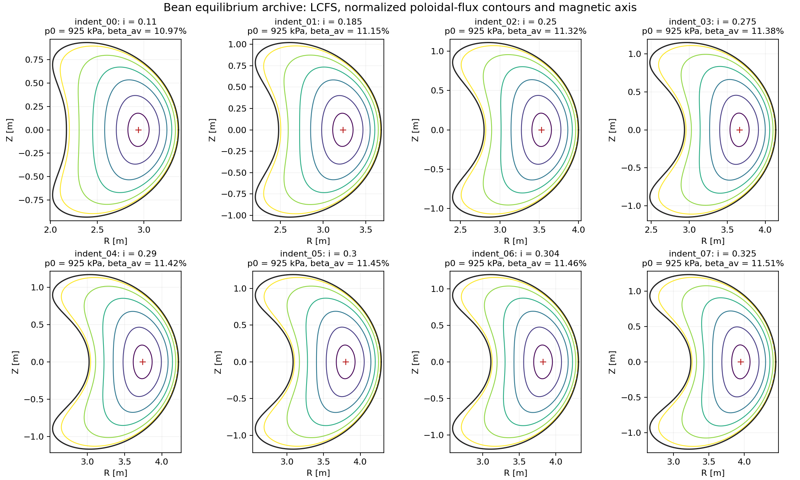

# Bean-shape equilibrium 인수인계 자료

Chance, Jardin & Stix, PRL **51**, 1963 (1983), Fig. 3 연구를 위해 DESC 평형 **344개**입니다. Indentation 8종에 각각 압력 43개를 계산했습니다. 모든 원본은 `accepted=true`, `quality_passed=true`이며, 안정/불안정 여부와 평형 수렴 여부는 별개입니다.



## 케이스 구성

| ID | Indentation i | 수 | R_geo [m] | a_geo [m] | beta_av 범위 [%] |
|---|---:|---:|---:|---:|---:|
| indent_00 | 0.11 | 43 | 2.696629 | 0.674157 | 0.5407–31.6507 |
| indent_01 | 0.185 | 43 | 2.944785 | 0.736196 | 0.5544–32.1543 |
| indent_02 | 0.25 | 43 | 3.200000 | 0.800000 | 0.5666–32.6149 |
| indent_03 | 0.275 | 43 | 3.310345 | 0.827586 | 0.5712–32.7933 |
| indent_04 | 0.29 | 43 | 3.380282 | 0.845070 | 0.5740–32.8997 |
| indent_05 | 0.3 | 43 | 3.428571 | 0.857143 | 0.5758–32.9703 |
| indent_06 | 0.304 | 43 | 3.448276 | 0.862069 | 0.5766–32.9983 |
| indent_07 | 0.325 | 43 | 3.555556 | 0.888889 | 0.5804–33.1442 |

각 계열의 중심압력 p0는 **50–2500 kPa**의 비균일 43점입니다. 정확한 값은 [catalog.csv](catalog.csv)에 있습니다. 전체 계열에서 기하학적 aspect ratio는 4, b/a는 1.386입니다. 기하학적 반지름은 계열마다 다르므로 같은 크기의 경계로 가정하지 마세요.

정규화 poloidal flux를 u라고 할 때 입력 profile은 다음과 같습니다.

```text
p(u) = p0*(1-u^2)^2
q(u) = 1.03 + 0.84375*u - 1.1775*u^2 + 3.50375*u^3
q_axis = 1.03, q_edge = 4.2
beta_av[%] = 200*mu0*integral(p dV)/integral(|B|^2 dV)
```

`beta_av_percent`는 전체 자기장 B^2를 사용하는 원본 정의입니다. Vacuum-reference B나 toroidal B만 사용하는 beta와 구분합니다. 원본 해상도는 **L64/M40/N0**, pressure/iota Hermite profile은 257 knots입니다. 경계식의 계수, 총 toroidal flux, solve tolerance와 생성 조건은 [run_definitions.json](provenance/run_definitions.json)에 보존했습니다.

## 파일 찾기와 사용

- `catalog.csv`, `catalog.json`: 케이스 파라미터, beta, Ip, q, 축 좌표, 품질 지표와 파일 경로.
- `gfiles/indent_XX/p_YYYY.geqdsk.gz`: gzip으로 압축한 표준 gfile. R 방향 129점, Z 방향은 종횡비에 맞춘 격자입니다.
- 각 gfile의 `.json`: 좌표 규약, 단위, export 품질과 원본 metadata 및 해시.
- `native/indent_XX/p_YYYY/equilibrium.h5`: 변경하지 않은 원본 DESC H5. 옆의 `metadata.json`에 원본 수렴 정보가 있습니다.
- `provenance/source_stability_summary.csv`, `source_surface_summary.csv`: 기존 spectral 계산의 안정성 판정과 표본 검사 범위. gfile을 통해 다시 계산한 결과는 아닙니다.

저장소 최상위 폴더에서 실행합니다.

```python
from eq_process import Equilibrium
eq = Equilibrium.from_geqdsk("data/bean/gfiles/indent_00/p_0000.geqdsk.gz")
surface = eq.extract_flux_surface(.5)
```

외부 프로그램에서 일반 텍스트 gfile이 필요하면 압축을 풉니다.

```bash
gzip -dk data/bean/gfiles/indent_00/p_0000.geqdsk.gz
```

더 높은 해상도로 다시 export할 때는 원본 H5를 사용합니다. DESC/JAX 설치는 필요하지 않습니다.

```bash
python -m equilibrium_io desc data/bean/native/indent_00/p_0000/equilibrium.h5 refined.geqdsk --nr 513
```

## 단위, 좌표, 적용 범위

**COCOS 1**, psi 단위 **Wb/rad**, R/Z는 m, p는 Pa, F는 T m, Ip는 A입니다. psi는 축에서 0, 경계에서 양수이며 `BR=+psi_Z/R`, `BZ=-psi_R/R`, `Bphi=F/R`입니다.

**유효한 평형 정보는 제공된 LCFS 내부입니다.** 원본은 fixed-boundary 평형이므로 진공장·coil·wall 정보가 없습니다. 직사각형 gfile 격자의 외부 값은 경계 법선 방향의 선형 연장이며, 진공 GS 해가 아닙니다. Limiter 배열은 비어 있습니다. External mode/진공장 연구에는 물리적인 외부장 해를 별도로 연결해야 합니다.

129점 gfile은 자료 교환을 위한 격자입니다. Ballooning처럼 미분에 민감한 계산은 native H5 경로 또는 고해상도 재export 후 수렴 검사를 사용하세요. 기존 stable 표시는 원본 spectral 계산의 유한한 자속면·phase 표본에 대한 결과입니다. 변환된 gfile 전체가 동일한 안정 판정을 낸다고 보증하는 표시는 아닙니다.

## 변환 검증

[validation.json](validation.json)에 전체 파일의 해시·COCOS·독립 FreeQDSK readback 결과가 있습니다. [desc_grid_convergence.json](desc_grid_convergence.json)은 작은/큰 indentation과 낮은/높은 압력의 대표 4점에 대해 129/257 R 격자를 비교합니다. psi_N=0.1, 0.5, 0.9, 0.99에서 자속면 적분으로 구한 q의 최대 상대오차는 129점에서 약 **0.146%**, 257점에서 약 **0.025%**입니다. 이 검사는 성장률의 수렴 검사를 대신하지 않습니다.

[native_ballooning_regression.json](native_ballooning_regression.json)에는 패키지로 옮긴 DESC 직접 solver와 원본 코드가 대표 2점에서 동일한 eigenvalue를 주는지 확인한 결과가 있습니다.

이 자료를 전달할 때는 gfile만 떼어 보내기보다 이 디렉터리 전체를 함께 전달하는 것을 권장합니다. 원본 H5와 metadata를 보존하면 변환 해상도를 바꾸거나 입력 조건을 추적할 수 있습니다.

## gfile reader 호환성 수정

기존 gfile 격자는 LCFS에 딱 맞아, 격자 끝의 0.1%를 제외하는 reader에서 psi_N=1에 도달하지 못했습니다. R/Z 각 방향으로 LCFS bounding box 폭의 2%씩 여유를 둔 격자로 다시 생성했습니다. 원본 H5, LCFS, 자기축, p/F/q profile은 바뀌지 않았습니다. 여유 영역도 기존과 같은 법선 선형 연장이며 진공장 해가 아닙니다.
